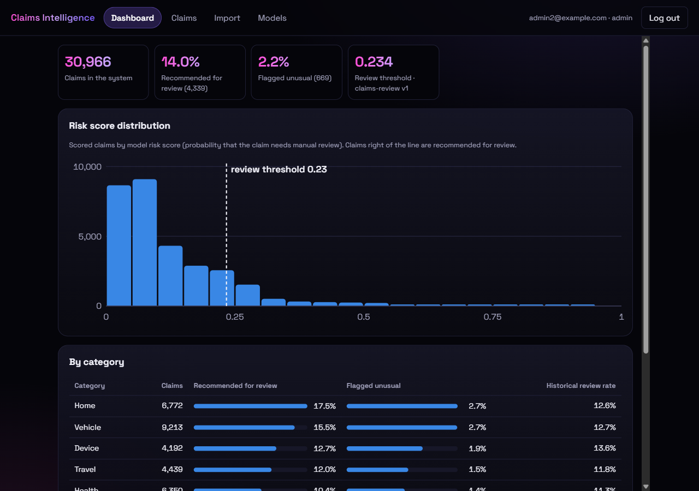
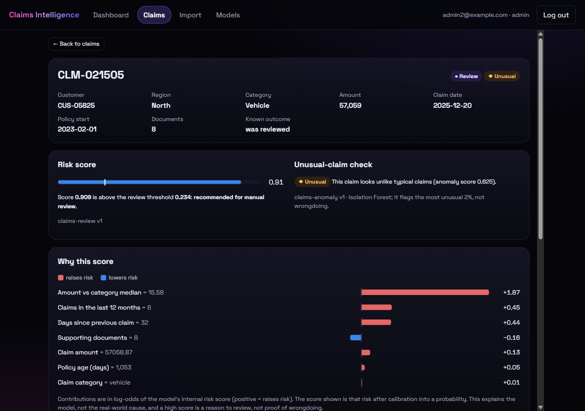
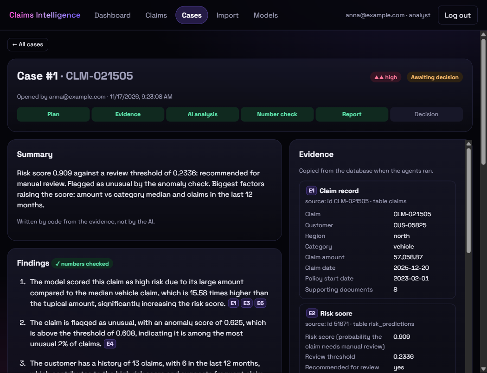
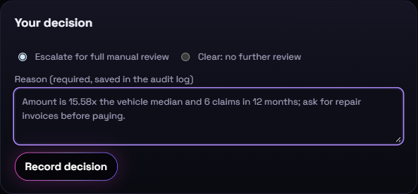
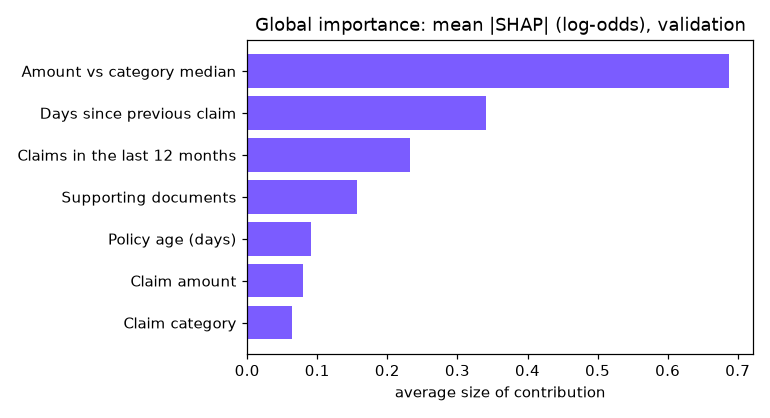

# AI Claims Intelligence Platform

Helps a claims team decide **which claims to look at first**. A machine-learning model predicts which claims need manual review, an anomaly detector flags unusual ones, every score is explained, and bounded LLM agents assemble an investigation report whose numbers are checked in code. **A person makes every decision.**

> **All data is synthetic** (generated by `ml/generate_data.py`). A high score is a reason to review a claim, never proof of wrongdoing. Runs fully locally: PostgreSQL, Ollama, no cloud services.

### Demo video

[**Watch the 2½-minute demo**](docs/demo-video.mp4): dashboard → a claim the two models disagree on → investigation → reviewer decision → model versions (narrated; the LLM's 70 seconds of CPU time are cut).

### Screenshots

| Dashboard | Claim with its explanation |
|---|---|
|  |  |
| **Investigation report (checked findings + evidence)** | **Reviewer decision** |
|  |  |

## Contents

- [Why this project](#why-this-project)
- [Results](#results)
- [Features](#features)
- [Architecture](#architecture)
- [How a claim is scored](#how-a-claim-is-scored)
- [How an investigation works](#how-an-investigation-works)
- [Security and responsible use](#security-and-responsible-use)
- [Tech stack](#tech-stack)
- [API](#api)
- [Getting started](#getting-started)
- [Running the tests](#running-the-tests)
- [Project structure](#project-structure)
- [Design decisions](#design-decisions)
- [Limitations and roadmap](#limitations-and-roadmap)

## Why this project

Claims teams can't check every claim. Reviewing at random wastes time; reviewing by gut feeling is inconsistent. This project shows the full path from raw records to a decision a person can defend:

1. **Predict** which claims are likely to need manual review, under a fixed workload (at most 15% of claims).
2. **Flag** claims that look unlike the rest, without needing fraud labels.
3. **Explain** every score (SHAP), so a reviewer sees *why*.
4. **Investigate** with agents that gather evidence through fixed tools and draft a report, where every number is verified against the database, and a second person decides.

It complements a document-based RAG project ([Enterprise Knowledge Assistant](https://github.com/Jathin4/enterprise-knowledge-assistant)): that one works on text, this one on structured records.

## Results

Everything below is on the **held-out test period** (the last 15% of claims by date, used once), unless stated otherwise. Full details: [model card](docs/model-card.md) · [training report](docs/model/README.md) · [agent benchmark](docs/agent-benchmark.md).

| | Result | For comparison |
|---|---|---|
| Review model PR-AUC | **0.342** | random 0.137 · best possible on this noisy data 0.448 |
| ROC-AUC · Brier | 0.747 · 0.106 | Brier of always guessing the base rate: 0.118 |
| At the chosen threshold (0.2336) | **14.5%** of claims sent to review, **36%** of them really needed it, **38%** of all claims needing review found | workload cap 15% |
| Fairness by region | flag rate 14.0–15.3%, recall 35–41% | no region treated very differently |
| Anomaly detector | 13% of its flags were planted anomalies | 1.4% for random flags |
| Drift check | a deliberately drifted batch: amount ratio PSI 0.59, category mix 0.40, documents missing 27% vs 3% | review rate jumped from 16% to 31.5%, warned at import |
| Investigation agents | Every finding graded by hand. **Held-out (14 claims never used for tuning): 61 of 69 correct (88%)** · tuning claims: 26 of 34 before fixes, 33 of 35 after · 2–3 min per claim on CPU | no invented number or fake citation reached a report; the remaining errors are wrong directions and invented comparisons |



## Features

**Claims and data**
- CSV import with **row-level errors** (a bad row is reported with its reason; good rows are kept), duplicate detection, 20 MB limit.
- A **drift check** on every import against the active model's training data (PSI per feature, category mix, missing documents).

**Machine learning**
- Point-in-time features (only information known when the claim was filed), time-based split, logistic-regression baseline, gradient-boosted trees, isotonic calibration.
- Threshold chosen by **cost** (a missed claim counts 10× an unnecessary review) under a **15% review cap**.
- **Model versioning**: every model file has a SHA-256 and is refused if it changed; one active version per model, switched by an admin; every score stores the model version, threshold and exact inputs.
- **Isolation Forest** anomaly detector, versioned separately.
- **SHAP** explanation for every claim, from the stored inputs.

**Investigations**
- An analyst opens a case; a fixed LangGraph workflow gathers 6 kinds of evidence, an LLM (qwen3:8b, local) drafts findings, **code checks every number**, and the report waits for a **different person** to escalate or clear it, with a written reason.

**Web app** (React): dashboard with the score distribution, claims table with search and filters, claim page with SHAP bars and history, CSV import with drift results, model versions, and the investigation workspace with live progress.

## Architecture

```
React app (Vite, :5174) ──/api──▶ FastAPI (:8002)
                                    ├─ auth: JWT, Argon2id, roles analyst / reviewer / admin, rate-limited login
                                    ├─ import → validate rows → claims ──▶ drift check (PSI)
                                    ├─ scoring: active model versions (SHA-256 checked) → risk_predictions, anomaly_results
                                    ├─ explanations: SHAP on the stored inputs
                                    └─ cases: worker thread → LangGraph graph ──▶ Ollama (qwen3:8b)
                                                                │
PostgreSQL 16 (:5433) ◀─────────────────────────────────────────┘
  claims · claim_imports · model_versions · risk_predictions · anomaly_results · cases · case_events · audit_events · users

ml/  (offline: generate data → EDA → train → anomaly → SHAP report; writes model-artifacts/ + docs/)
```

**The separation rule:** the ML code in `ml/` is used unchanged by the API (`ml/features.py` builds features in training and serving), so the scores in the app equal the scores in training (checked: max difference 0.00005).

## How a claim is scored

1. **Features** from the claim and the customer's earlier claims only: amount, amount ÷ category median (medians from training data), category, documents, policy age, claims in the previous 365 days, days since the previous claim.
2. The **active** review model gives a calibrated probability. At or above **0.2336** → "recommended for review".
3. The **active** anomaly detector gives an unusualness score; above 0.6085 → "unusual" (about the top 2%).
4. Both results are stored with the model version, threshold and inputs. **SHAP** explains the score on request from those exact inputs.

How the threshold was chosen: on the validation period, every threshold was costed as 10 × missed claims + 1 × unnecessary reviews, keeping the review rate at or under 15%; the cheapest was kept. The test period was used once, at the end.

## How an investigation works

```
plan → gather_evidence → analysis (LLM) → verification ─┬─ passed / no retries left → report → reviewer decides
                            ▲                            │
                            └──── problems: 1 rewrite ───┘
```

| Step | Who | What |
|---|---|---|
| plan | code | Picks the lookups by fixed rules |
| gather_evidence | code | 6 read-only tools: claim record, risk score, SHAP explanation, anomaly check, customer history, category baseline. Numbered E1… and frozen into the case |
| analysis | LLM | Up to 5 findings, each listing the evidence it uses, and up to 3 questions for the reviewer. JSON enforced by Ollama + Pydantic |
| verification | code | Every number, date and ID must appear in the cited evidence (normal rounding allowed); comparisons between two numbers must point the right way; no accusatory words. Failures go back once with the exact problems |
| report | code | Summary **built by code from the evidence** (so it can't contradict it), checked findings, failed statements kept apart, limitations |
| decision | person | A reviewer or admin **who didn't open the case** escalates or clears it, with a required reason. Enforced in the API and by a database constraint; audited |

The LLM never chooses the claim, never calls tools and never writes SQL: tools take the claim ID from the case, and the LLM only reads their output.

### Problems found by reading real reports

Every number in the first reports was correct, yet some sentences were wrong:

| What the LLM wrote | Why the number check passed it | Fix |
|---|---|---|
| The vehicle review rate 12.7% is "higher" | No baseline in the evidence | The evidence now includes the rate for **all** categories (12.4%) |
| A claim **not** flagged "is in the top 2% of claims flagged as unusual" | "2%" was in the evidence, on its own line | The fact now reads "no: NOT among the most unusual 2% of claims" |
| "A higher rate (11.3%) compared to all categories (12.4%)" | Both numbers were right | A code check that comparisons between two numbers point the right way |

What the checks still can't catch: a number attached to the wrong label, a comparison without numbers, weak reasoning. That's why the app shows the evidence beside every finding.

The [agent benchmark](docs/agent-benchmark.md) then graded every finding by hand on 7 rule-picked claims (borderline scores, the two models disagreeing, missing documents, no history, drifted data). Round 1 found four more failure patterns (a score rounded to 3 decimals next to a 4-decimal threshold, a SHAP value attached to the wrong factor, a guessed direction, hedging) and one miss: the customer who filed **the same amount three times in five days**. After fixing the evidence and the prompt, 33 of 35 findings were correct on those claims, and **61 of 69 (88%) on 14 new claims** never used for tuning. The held-out run also caught a false alarm in my own comparison check ("the last 12 months" read as a number being compared), now fixed.

## Security and responsible use

- Passwords hashed with **Argon2id**; JWT tokens (60 min); login rate limit (5 failures per email or 20 per IP in 15 minutes, counted from the audit log).
- Roles: **analyst** (import, score, open cases), **reviewer** (decide cases), **admin** (everything; activates models). A test walks every endpoint and fails if one works without a token.
- **Four-eyes rule** on decisions, also as a database constraint.
- Audit log for logins, imports, scoring runs, model activations, case openings and decisions (with the reason).
- Model files are loaded only if their SHA-256 matches the registered one (unpickling runs code).
- Reports never call a claim fraud: the word is blocked by the checker; the model card states the intended and forbidden uses.

## Tech stack

| Area | Tools |
|---|---|
| ML | Python 3.14, pandas 3, scikit-learn 1.9 (HistGradientBoosting, Isolation Forest, isotonic calibration), SHAP 0.54, matplotlib |
| API | FastAPI, SQLAlchemy 2, Alembic, Pydantic, pwdlib (Argon2id), PyJWT |
| Agents | LangGraph 1.2, Ollama (qwen3:8b), httpx |
| Database | PostgreSQL 16 |
| Web | React 19, Vite 8, TypeScript; charts hand-made in SVG with a colour-blind-safe palette (validated) |
| Tests | pytest (28 tests: features, training, data and model contracts, drift, API, permissions, cases, checker) |

## API

| Method | Path | Who | What |
|---|---|---|---|
| POST | `/api/auth/login` | anyone | Token (form fields `username`, `password`) |
| GET | `/api/auth/me` | signed in | Current user |
| POST | `/api/claims/import` | analyst | Upload a CSV; returns counts, row errors, drift |
| GET | `/api/claims` | signed in | Search by claim/customer ID; filter by category / recommended / unusual; sort by score, date, amount |
| GET | `/api/claims/{id}` | signed in | Claim, its score, anomaly result, inputs, earlier claims |
| GET | `/api/claims/{id}/explanation` | signed in | SHAP contributions |
| POST | `/api/predictions` | analyst | Score every claim the active model hasn't scored |
| GET | `/api/models` | signed in | Model versions with validation and test metrics |
| POST | `/api/models/{id}/activate` | admin | Switch the active version |
| GET | `/api/stats` | signed in | Dashboard numbers |
| POST | `/api/cases` | analyst | Open an investigation |
| GET | `/api/cases`, `/api/cases/{id}` | signed in | Cases; detail with evidence, report, activity |
| POST | `/api/cases/{id}/retry` | analyst | Re-run a failed investigation |
| POST | `/api/cases/{id}/decision` | reviewer | Escalate or clear, with a reason |

Interactive docs: http://127.0.0.1:8002/docs

## Getting started

### Prerequisites

- Python 3.12+ (built on 3.14), Node.js 20+, PostgreSQL 16, [Ollama](https://ollama.com) with `ollama pull qwen3:8b` (only needed for investigations).

### 1. Install

```powershell
git clone https://github.com/Jathin4/claims-intelligence.git
cd claims-intelligence
python -m venv .venv
.\.venv\Scripts\Activate.ps1          # macOS/Linux: source .venv/bin/activate
pip install -r requirements.txt
cd frontend; npm install; cd ..
```

### 2. Database and settings

```sql
-- in psql, as a superuser
CREATE ROLE claims_app LOGIN PASSWORD 'choose-a-strong-password';
CREATE DATABASE claims_intelligence OWNER claims_app;
CREATE DATABASE claims_intelligence_test OWNER claims_app;
```

Copy `.env.example` to `.env` and fill in the password and a new `SECRET_KEY`. Then create the tables:

```powershell
cd backend
python -m alembic upgrade head
```

### 3. Data and models

```powershell
python ml/generate_data.py --seed 42     # data/claims.csv (same seed → identical file)
python ml/eda.py                         # docs/eda
python ml/train.py                       # model-artifacts/claims-review-v1 + docs/model
python ml/anomaly.py                     # model-artifacts/claims-anomaly-v1
python ml/shap_report.py                 # docs/model/shap_importance.png

cd backend
python manage.py register-model ../model-artifacts/claims-review-v1.json --activate
python manage.py register-model ../model-artifacts/claims-anomaly-v1.json --activate
python manage.py import-csv ../data/claims.csv
python manage.py score
python manage.py create-user anna@example.com --role analyst     # asks for a password
python manage.py create-user ravi@example.com --role reviewer
python manage.py create-user admin@example.com --role admin
```

Optional test batches for the drift check: `python ml/make_batch.py` and `python ml/make_batch.py --drift` (see `--help`), then import them in the app.

### 4. Run (two terminals)

```powershell
# terminal 1: API
cd backend
python -m uvicorn app.main:app --port 8002

# terminal 2: web app on http://localhost:5174
cd frontend
npm run dev
```

## Running the tests

```powershell
$env:PYTHONPATH = "backend"
python -m pytest tests backend/tests -q
```

The API tests use the separate `claims_intelligence_test` database and a tiny model trained on the fly; the agent tests replace the LLM with a stub. The model-quality contracts read `model-artifacts/` and are skipped until the models are trained. Agent quality on real claims: `python backend/manage.py benchmark-agents` (7 tuning claims) or `--heldout` (14 claims never used for tuning); about 2–3 minutes per claim on CPU.

## Project structure

```
ml/                    offline pipeline (also imported by the API)
  generate_data.py     synthetic claims, planted anomalies, noisy label
  features.py          point-in-time features: the single source for training and serving
  eda.py · train.py · anomaly.py · explain.py · shap_report.py · drift.py · make_batch.py
backend/
  app/
    models.py          tables          importer.py   CSV validation
    scoring.py         active models, SHAP, drift     security.py   auth, roles, audit
    agents.py          LangGraph graph + tools        verify.py     number checks
    cases.py           investigation runner, decisions
    benchmark.py       agent benchmark                routers/      auth, claims, models, cases
  alembic/             migrations      manage.py     admin commands
  tests/               API, permissions, cases, checker
tests/                 features, training, drift, contracts
frontend/src/          Dashboard, Claims, ClaimDetail, Cases, Import, Models
docs/                  data.md, eda/, model/, model-card.md, agent-benchmark.md, screenshots/
```

## Design decisions

- **Time-based split, warm-up year.** Claims are split by date, never at random, and the first year is history only, so no model sees the future and every claim has a full year of past claims.
- **Calibrated model chosen over a slightly higher PR-AUC.** The uncalibrated model ranked 0.008 better but its probabilities were far off (Brier 0.18 vs 0.10); a threshold on a calibrated probability means what it says.
- **Threshold from cost and workload,** not from 0.5 or F1.
- **Region kept out of the features** so it can be used to check fairness.
- **No LangGraph checkpointer.** The graph ends at the report; a decision that may take days is a database record, not a paused graph. A case interrupted by a restart is simply run again (the steps only read data).
- **Summary written by code, findings by the LLM, numbers checked by code.** In Project 1 an LLM summary once contradicted a verified finding; here the summary can't.

## Limitations and roadmap

- Synthetic data: real claims, real labels (and the bias in past review decisions) would need new validation and a legal review.
- Recall at the chosen threshold is 38%; the threshold is a business choice between workload and missed claims.
- The anomaly detector is weak (13% precision); useful only next to the score.
- The number checker can't catch a number attached to the wrong label, or weak reasoning.
- CPU-only LLM: about 2–3 minutes per investigation.
- Next: retrain on a schedule when drift is large, document content as a feature, a check that each SHAP value is described in the right direction.
