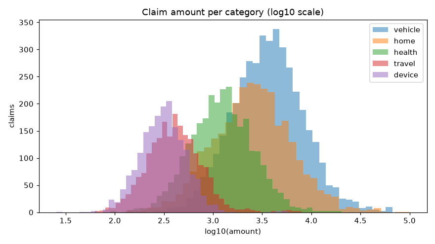
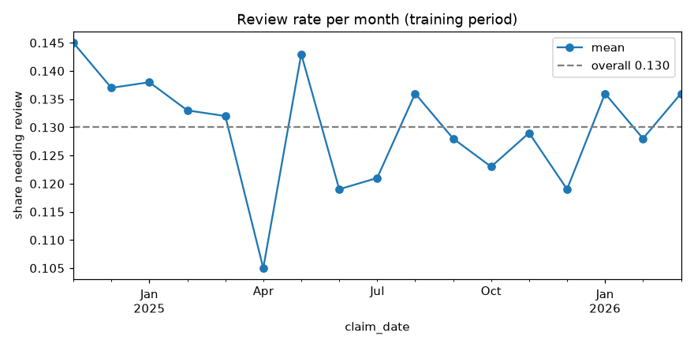
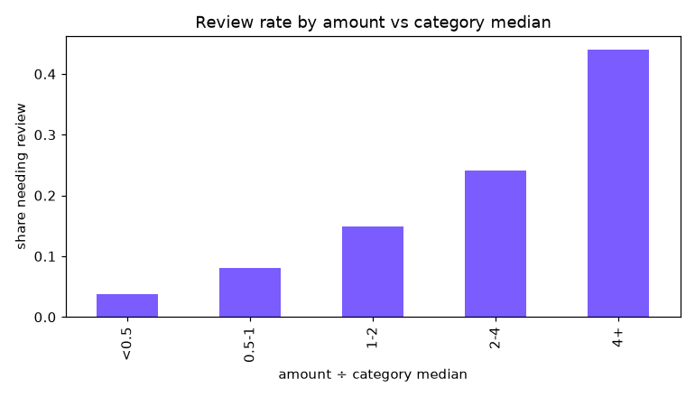
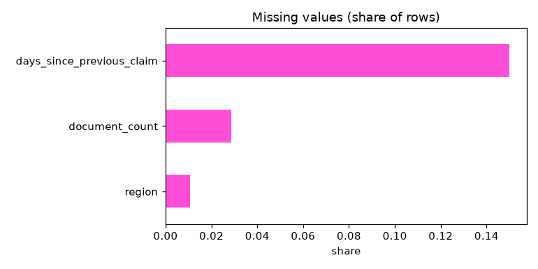

# EDA: training period

Explored the oldest 70% of the modelled claims only (14,060 of 20,087 claims from 2024-11-01; the year before is history only), 2024-11-01 to 2026-03-13. Validation and test periods were not looked at.

## Shape and types

```
rows 14,060 · columns 13
duplicate claim_id: 0

claim_id                                str
customer_id                             str
region                                  str
policy_start_date            datetime64[us]
claim_date                   datetime64[us]
claim_category                          str
claim_amount                        float64
document_count                      float64
manual_review_required                int64
claim_history_count                   int64
days_since_previous_claim           float64
policy_age_days                       int64
amount_vs_category_median           float64
```

## Target balance

```
manual_review_required: 0.130 positive (1,828 of 14,060)
-> imbalanced: use PR-AUC, recall, precision; class weights; never accuracy
```

## Missing values (share of rows)

```
region                       0.0108
document_count               0.0288
days_since_previous_claim    0.1499
```

## Claim amount per category

```
                 count     50%      95%      max
claim_category                                  
device          1841.0   312.0    712.0   5710.0
health          2859.0  1213.0   4033.0  20320.0
home            3098.0  2541.0  11141.0  99181.0
travel          2044.0   401.0   1072.0   7992.0
vehicle         4218.0  3662.0  13837.0  66756.0
```

## Review rate by category

```
                 mean  count
claim_category              
device          0.156   1841
health          0.113   2859
home            0.132   3098
travel          0.124   2044
vehicle         0.132   4218
```

## Review rate by region (fairness check: large gaps would need a reason)

```
            mean  count
region                 
(missing)  0.086    152
central    0.127   2151
east       0.134   2771
north      0.128   3376
south      0.135   2973
west       0.128   2637
```

## Review rate by amount_vs_category_median

```
                            mean  count
amount_vs_category_median              
<0.5                       0.037   2484
0.5-1                      0.080   4545
1-2                        0.149   4657
2-4                        0.242   1863
4+                         0.440    511
```

## Review rate by days_since_previous_claim

```
                            mean  count
days_since_previous_claim              
<30                        0.234   2003
30-60                      0.237   1504
60-180                     0.118   3889
180+                       0.087   4556
```

## Review rate by claim_history_count

```
                      mean  count
claim_history_count              
0                    0.070   3723
1                    0.094   3795
2-3                  0.156   4377
4+                   0.246   2165
```

## Review rate by document_count

```
                 mean  count
document_count              
0               0.172   1010
1-2             0.144   4974
3-4             0.114   4701
5+              0.116   2970
```

## Review rate by policy_age_days

```
                  mean  count
policy_age_days              
<90              0.091    121
90-365           0.088    774
365+             0.133  13165
```

## Review rate and volume per month

```
             mean  count
claim_date              
2024-11     0.145    816
2024-12     0.137    982
2025-01     0.138   1043
2025-02     0.133    870
2025-03     0.132    812
2025-04     0.105    762
2025-05     0.143    712
2025-06     0.119    738
2025-07     0.121    940
2025-08     0.136    897
2025-09     0.128    732
2025-10     0.123    722
2025-11     0.129    773
2025-12     0.119    991
2026-01     0.136   1001
2026-02     0.128    937
2026-03     0.136    332
```

## Single-feature ROC-AUC (leakage check: > 0.9 would be suspicious)

```
amount_vs_category_median    0.704
claim_history_count          0.647
days_since_previous_claim    0.637
claim_amount                 0.623
document_count               0.538
policy_age_days              0.509

flagged: none
```

## Charts





