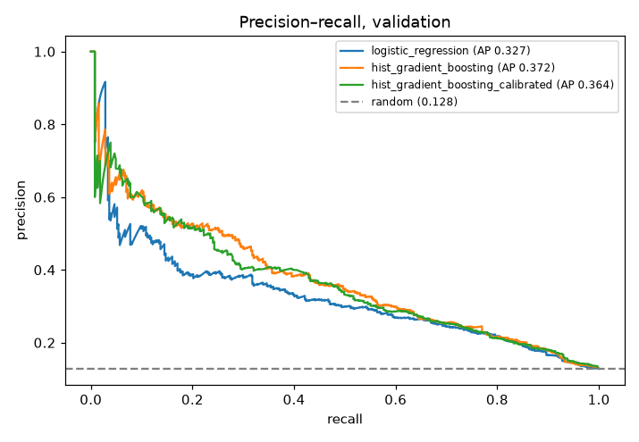
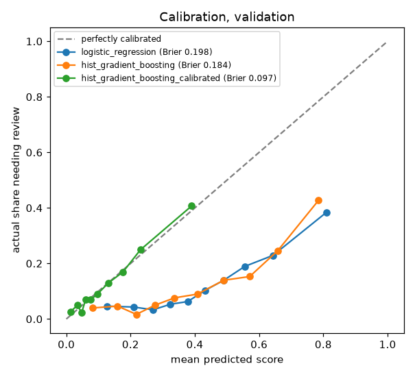
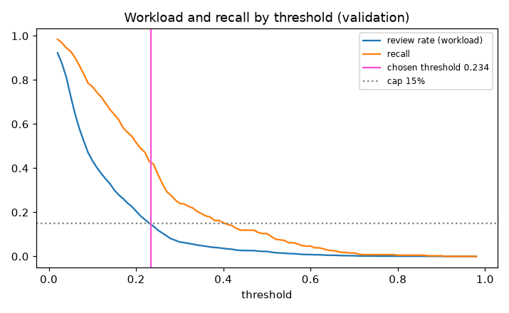

# Model report: claims-review v1

All results are on **synthetic** data. The score means "needs manual review", not fraud.

Data: `data/claims.csv` (sha256 10277c6da820…). Train ['2024-11-01', '2026-03-13'] (14,060 claims), validation ['2026-03-13', '2026-07-10'] (3,013), test ['2026-07-10', '2026-10-31'] (3,014).

## Validation (all choices made here)

| Model | PR-AUC | ROC-AUC | Brier | Precision* | Recall* | Review rate* |
|---|---|---|---|---|---|---|
| logistic_regression | 0.3267 | 0.7464 | 0.1984 | 0.3371 | 0.3902 | 0.1487 |
| hist_gradient_boosting | 0.3721 | 0.7653 | 0.184 | 0.3848 | 0.4315 | 0.144 |
| hist_gradient_boosting_calibrated | 0.3638 | 0.7632 | 0.0974 | 0.3787 | 0.4315 | 0.1464 |

\* at each model's own lowest-cost threshold (cost = 10 × missed + 1 × unnecessary, review rate ≤ 15%).

Chosen: **hist_gradient_boosting_calibrated**, threshold **0.2336**.

Ceiling: the generator's hidden probability scores PR-AUC 0.4783 on validation and 0.4478 on test: the best any model could do, because the labels contain random noise.

## Test (used once)

PR-AUC 0.3419 · ROC-AUC 0.7465 · Brier 0.1055 · at threshold 0.2336: precision 0.3624, recall 0.3826, review rate 0.1447 (TP 158, FP 278, FN 255, TN 2323).

## Fairness check by region (test, at the threshold)

| Region | Claims | Flag rate | TPR (recall) | FPR |
|---|---|---|---|---|
| central | 425 | 0.148 | 0.414 | 0.106 |
| east | 579 | 0.145 | 0.378 | 0.107 |
| north | 708 | 0.14 | 0.357 | 0.111 |
| south | 688 | 0.14 | 0.348 | 0.107 |
| west | 587 | 0.153 | 0.413 | 0.105 |

